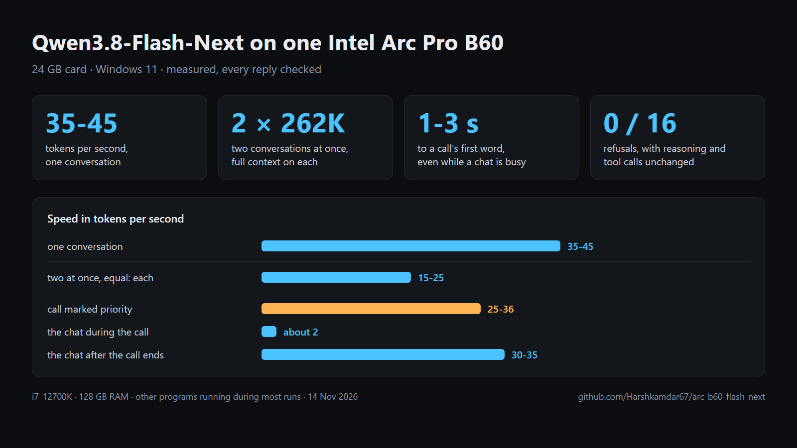

# Qwen3.8-Flash-Next on one Intel Arc Pro B60 (24 GB), Windows

A working setup for running Qwen3.8-Flash-Next (IQ3_S) on a single Arc Pro B60 under Windows with
[Strata](https://github.com/Niko1221/Strata): two streams with 262K context each, per-request priority lanes,
a run-time refusal vector, and no corrupted output. Everything here was measured on one machine and the text of
every reply was checked.

Machine: i7-12700K, 128 GB DDR4-2667, Arc Pro B60 24 GB, Windows 11. Measured 2026-11-14.

## Results

| case | result |
|---|---|
| one stream | 35-45 tok/s decode |
| two equal streams | 15-25 tok/s each |
| one request sent with `"priority": 1` | it runs at 28-29 tok/s, the other at 5-8 |
| one request sent with `"priority": 4` | it runs at 29-36 tok/s, the other at about 2, and back to 27-35 when it ends |
| priority 4, 95K tokens of context on each stream | 23.5 tok/s and 1.5 |
| two equal streams with 200K tokens of context each | 9-11 tok/s each (one run, 48% CPU load from other jobs) |
| a short high-priority turn beside a request that is generating | first token in 0.8-2.3 s |
| a short high-priority turn while another request reads a 95K prompt | first token in 2.1-3.2 s, 19-30 tok/s |
| prompt reading | 935 tok/s with 4K chunks (789 tok/s on a 200K prompt) |
| refusals on a 16-prompt probe | 0/16 with the vector, 11/16 without |
| 16 reasoning questions, 6 tool calls | 16/16 and 6/6, the same with and without the vector |
| five opencode coding tasks | 5/5 with the vector (an earlier run without it: 3/5; single runs) |
| memory | 59 GB working set, 82-84 GB committed, 22.7 GiB on the card |

Other programs were running during most of these runs (CPU load 7-50% before a run), and in the last ones the engine
ran at below-normal priority. Nothing was measured on a fully idle machine after the last change. Raw numbers and the
history of how they were reached are in [results/RESULTS.md](results/RESULTS.md).

## Demo



[demo/flashnext-b60-demo.mp4](demo/flashnext-b60-demo.mp4) is a 45-second screen recording of `bench/webdemo/demo.html`,
real time, taken while the engine ran at below-normal priority with other programs busy on the machine. In that take:
one chat, 340 tokens at 35.3 tok/s, first word after 1.3 s; then a priority-4 call arriving while a chat request is
generating: the call's first word after 1.7 s, 283 tokens at 20.7 tok/s, the chat at about 2 tok/s meanwhile and back
above 20 once the call ends. The large number is streamed pieces per second while a stream runs (a little low) and
the server's token count when it ends. `bench/demo.py` is a terminal version of the same thing.

## What is in here

- `patches/0001-batch-priority-lanes-and-adaptive-tier.patch`: the engine change (116 lines, `generate.cpp` and `server.py`).
  It is commit `bc40c907` on branch `b60-windows` of [Harshkamdar67/Strata](https://github.com/Harshkamdar67/Strata/tree/b60-windows),
  which also carries the Windows SYCL port the patch sits on.
- `config/strata-iq3_s-b60-lanes-esp.json`: the server config. Paths are placeholders, change them to yours.
- `bench/fnbench.py`: N streams with a prompt of a given size, optional priority, text check.
- `bench/calltest.py`: short high-priority turns arriving while a long low-priority request runs.
- `bench/demo.py`: the terminal demo. `bench/webdemo/`: the page in the video (`python serve.py`, then open http://127.0.0.1:8099).
- `results/`: results log and the draft report on the corrupted-output cause.

## Setup

1. Build the Windows SYCL engine from the `b60-windows` branch above (oneAPI 2025 DPC++ and MKL, Level Zero).
2. Get `ISTA-DASLab/Qwen3.8-Flash-Next-GSQ-RCO-GGUF`, the IQ3_S pair of shards, pack it with Strata's packer, and
   fetch the MTP draft head.
3. Edit the paths in `config/strata-iq3_s-b60-lanes-esp.json`.
4. Start it:
   ```
   set PATH=C:\oneapi\Library\bin;%PATH%
   python sycl\serve\server_intel.py --engine strata --config config\strata-iq3_s-b60-lanes-esp.json --port 8080
   ```
   It needs about 60 GB of free RAM and serves an OpenAI-compatible API on `http://127.0.0.1:8080/v1`.

## The settings that matter

**`STRATA_SPIN_MAX=200000000`.** This is the corrupted-output fix. The card waits for the CPU's share of each layer
with a bounded spin. A B-series card on Windows gets a bound of 20,000 reads by default, and with the CPU computing
the experts the card does not hold, the wait expires whenever the CPU is late. The window then goes on without those
outputs and the reply turns into `!!!!`, at normal speed, so a benchmark that does not read the text reports a good run.

| STRATA_SPIN_MAX | machine | bad replies |
|---|---|---|
| default (20,000) | quiet | about 10% |
| 2,000,000 | quiet | 0 of about 110 |
| 2,000,000 | engine pinned to 2 logical cores | 1 of 4 |
| 200,000,000 | engine pinned to 2 logical cores | 0 of 8 |

Speed is the same for all three on a quiet machine. The starved samples are small, and a wait that still expires gives
a wrong window as before: this is a longer bound, not a detection.

**`"drafting": "mtp"`.** Without it the server chose another drafter on this card and accepted 0 drafts.

**`--batch 2 --batch-mtp`.** Two slots, each with its own 262K context, each drafting one token.

**`--prefill 4096`.** A prompt chunk cannot be interrupted, so its size is the longest a high-priority request waits
behind someone else's prompt read:

| chunk | prompt read | first token of a high-priority turn during a 95K read |
|---|---|---|
| 32K | 1,500 tok/s | 17-25 s |
| 8K | 1,150 tok/s | 5-8.5 s |
| 4K | 935 tok/s | 2.1-4.2 s |
| 2K | 725 tok/s | 1.6-4.4 s |

**The control vector.** `--control-vector-scaled FILE:1.0 --control-vector-layer-range 4 44 --cvec-mode project --cvec-dir per-layer`
with the vector file that ships in the Strata repository
(`data/experimental-speed-projection/`), and `"sampling": {"experimental_speed_projection": true}` to make it the
default. The weights on disk are the standard ones; the projection is applied at run time and only in this engine. A
request can turn it off with `"experimental_speed_projection": false`. I did not make the vector.

## Priority lanes

A request may carry `"priority": N` (an integer, or `"high"` for 1). Requests of equal priority behave as before.

```json
{"model": "x", "priority": 4, "messages": [{"role": "user", "content": "..."}]}
```

- Decode: while slots of different priority are live, a slot `gap` levels below the top joins one batch window in
  `gap * STRATA_LANE_SHARE` (default 4; 0 makes it wait). When the higher request ends, every slot is in every window again.
- Prompt reads: a batched read below a decoding slot's priority waits for that reply before it borrows cache slots and
  before each chunk, for at most `STRATA_LANE_WAIT_MS` per request (default 4000). A read above the decoding slots is
  not interleaved with them. The server asks a read in progress to give way when a request of higher priority is waiting.
- The adaptive expert tier now also runs in the batch windows (`STRATA_BATCH_ADAPT=0` turns it off). It only ran in the
  single-stream loop, so with two streams the card's expert cache stayed as the last single request left it: a stream
  on different text had 46-54% cache hits and ran at 17-19 tok/s. It does not run while a prompt read has cache slots
  on loan, and its swaps land before a read borrows slots. Leaving out the first condition crashed the engine, leaving
  out the second corrupted replies; both were found by `calltest.py`.

## Limits

- One machine, one card, one model and quant. Single runs for most rows.
- The patch has no unit test and has not been proposed upstream.
- A low-priority request that arrives during a long high-priority reply waits about 8 s for its first token.
- Committed memory is 82-84 GB. On a 64 GB machine this configuration does not fit.

## License

MIT for the files in this repository. Strata, the model and the control vector have their own licenses.
